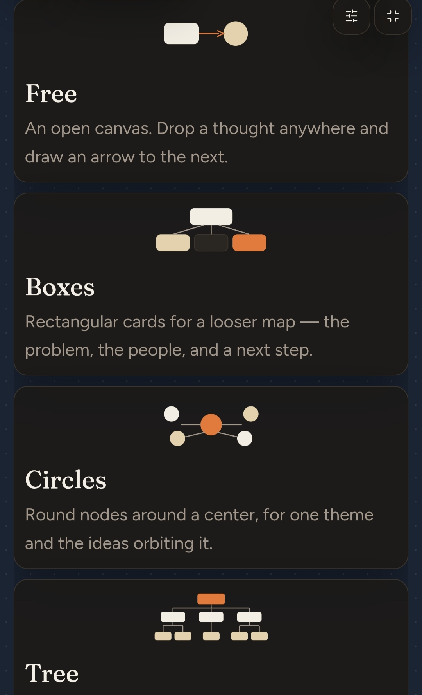
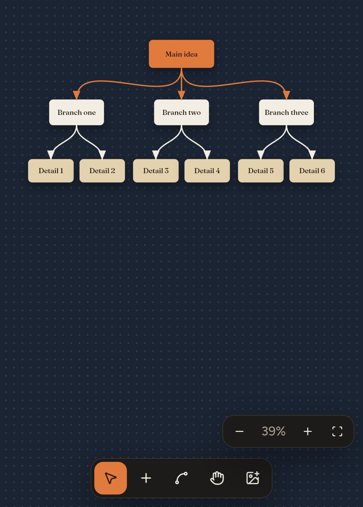
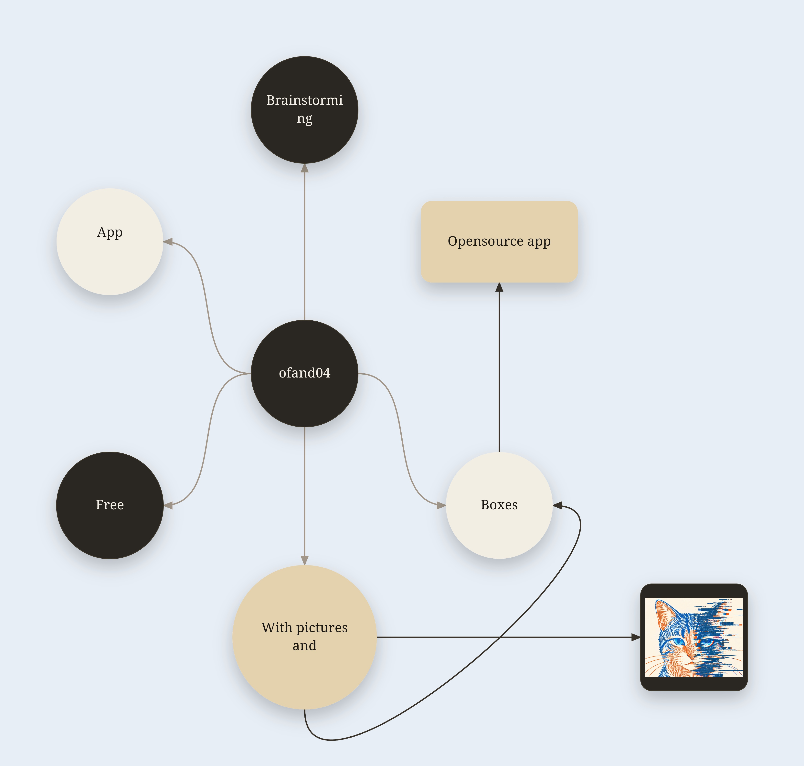

  

## Filament

Filament is a visual brainstorming application for creating, organizing, and connecting ideas.

## Screenshots

  
  

  
  

## Requirements to build from source

- Git
- Node.js 22 or later
- Java JDK 21
- Android SDK
- Android SDK Platform 35
- Android SDK Build-Tools

1. Clone the repository

git clone https://github.com/ofand04/Filament.git
cd Filament

2. Install dependencies

npm ci

3. Build the Android APK

cd android
./gradlew assembleDebug

Gradle automatically builds the web application and synchronizes the Capacitor Android project as part of the build.

4. Find the APK

After a successful build:

android/app/build/outputs/apk/debug/app-debug.apk

Building a release

cd android
./gradlew assembleRelease

The locally generated release APK is unsigned unless a signing configuration is provided.

Automated builds

Filament includes a GitHub Actions workflow at:

".github/workflows/build-release.yml"

The workflow builds the Android release and publishes it through GitHub Releases.

You can trigger it manually from the repository's Actions tab.

Technologies

- React
- TypeScript
- Vite
- Capacitor
- Android Gradle Plugin

License

MIT
